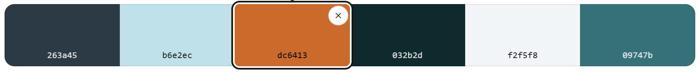
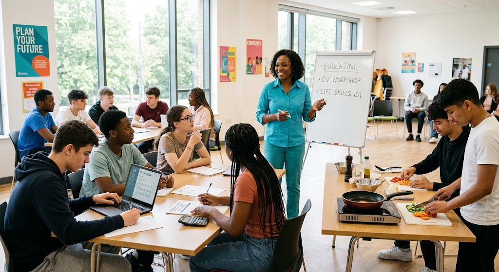
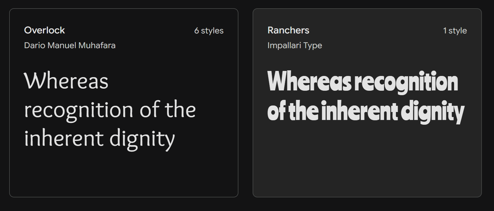
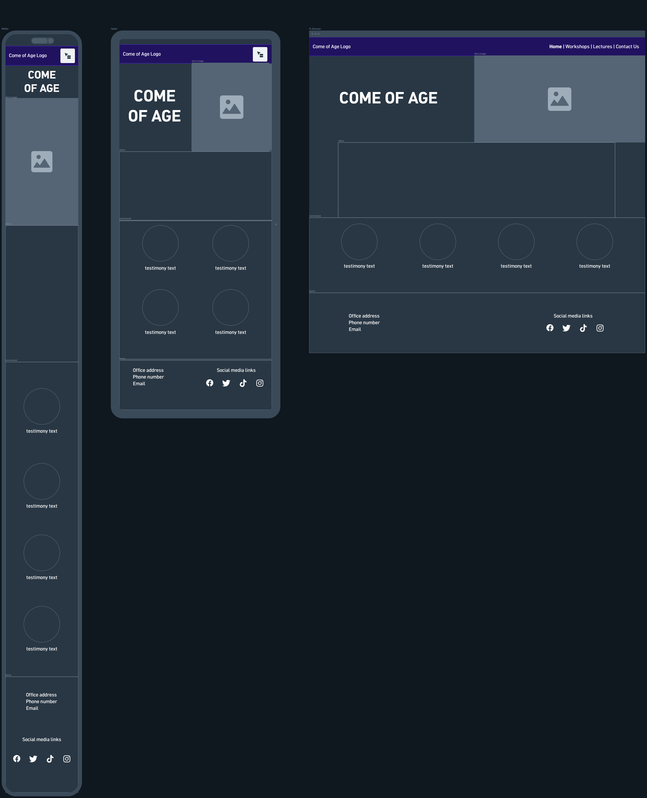
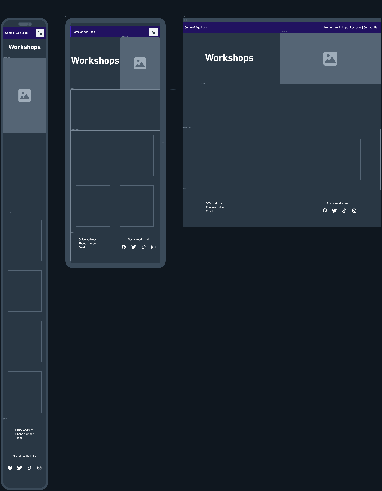
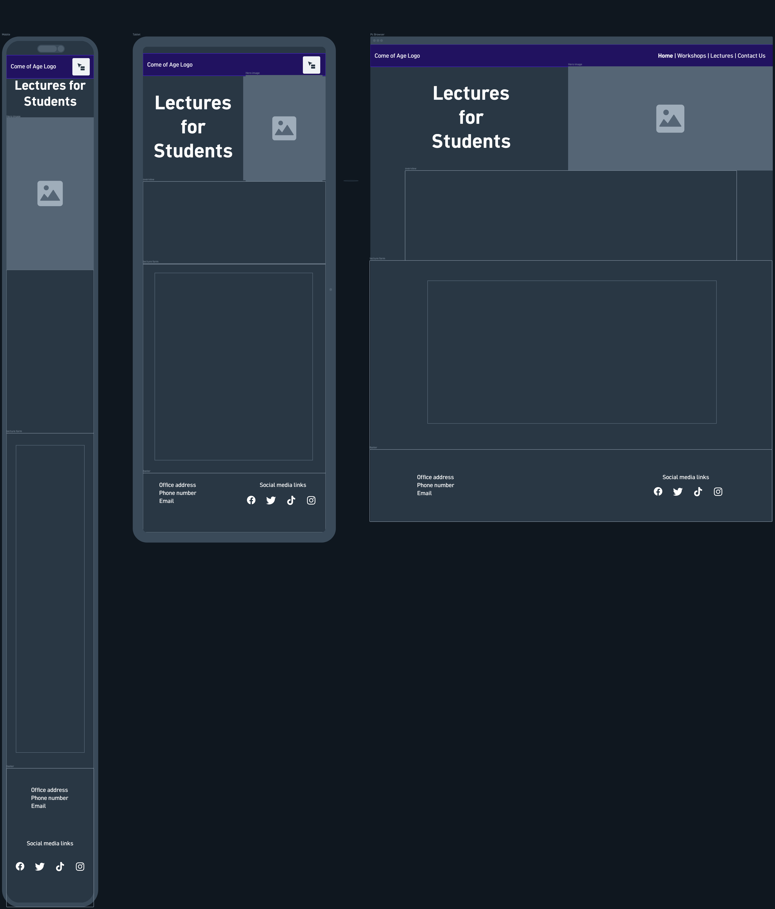
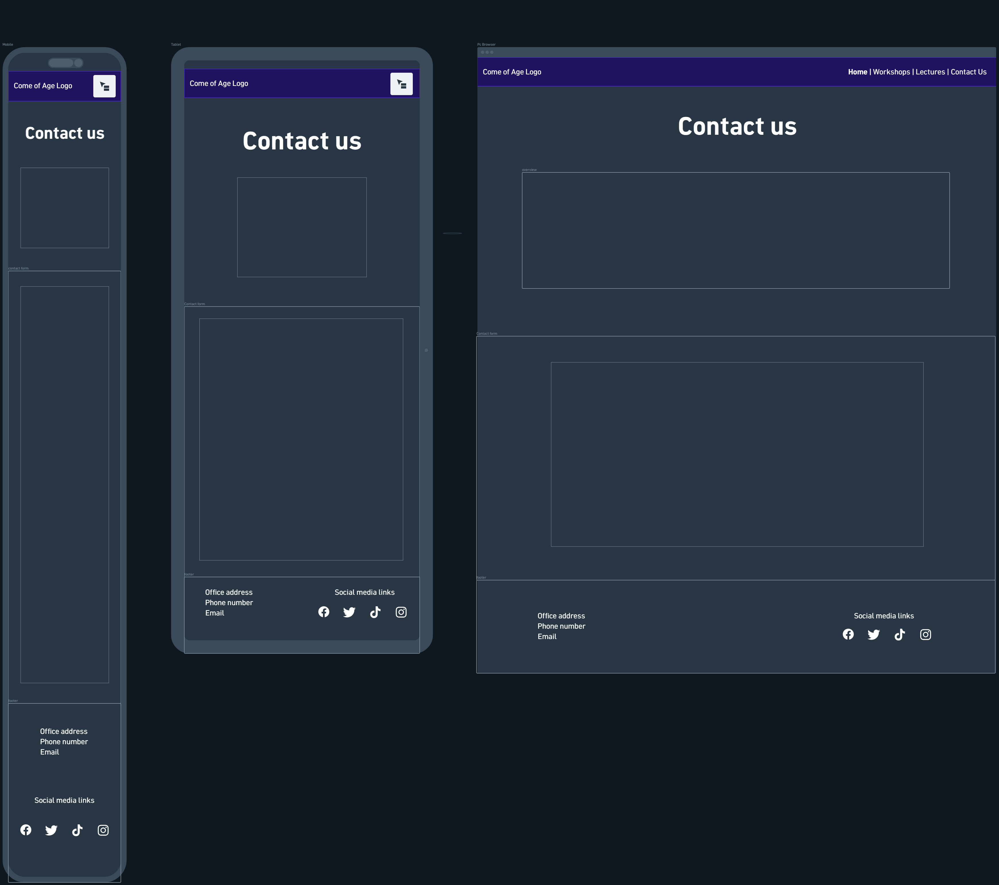

# Come-of-Age
A non profit organisation that is dedicated to teaching fundamental skills and requirements as they grow into adults. Learning how to Adult is not fully taught while in full time education, which is why this organisation provides valuable knowledge, to see today's generation is set up for success. They provide in person lectures and workshops relating to: Personal Finance, Job Searching and CV writing, House Keeping, and Raising a Family. 

This README is used to document the progress of the project and the usage of the website. Other developers of this project can refer to this document in order to better understand this project and its goals. Please make regular changes to this document when making further changes to the project.

## Project Goals

### Business Goals
* Increase the number of clients
* Expand the reach of the brand
* Establish a presence online
* Provide relevant and useful links to online resources

### User Goals
* Responsive Website so it can be used on all platforms
* A means of contacting the business 
* A place to book upcoming workshops 
* Infromation about the workshops and lectures 

## User Experience

### User Stories
1. As a student, I want a responsive website so I can view on my phone and computers at school.
2. As a school staff member, I need a simple form to contact the organisation so I can coordinate workshops and lectures for students.
3. As a student, I need a clear list of workshops so I can find the one i need easily.
4. As a student, I would like to sign up to a newsletter so i can find up-to-date information about future workshops and events.
5. As a potential client, I need to see clear images and layout so I can better understand the information given on the site.
6. As a teacher, I would like to see a number of links to social media and online resourses so i can see if booking  a workshop is good for my students.
7. as A student , I want to read testemonials from these workshops to see if joining one is right for me.
8. As a client, I need there to be a user friendly layout and navigation so I can quickly find the information I need about the services provided.

### Features on release

1. A simple navigation bar that colapses into a drop down on small screens
2. sign-up form for newsletter
3. responsive website for all devices
4. contact form for feedback and inquiries
5. footer with links to social media

### Design 

#### Colour Scheme

 

* Primary Text - #032b2d (charcoal)
* Secondary Text - #263a45 (Dark navy)
* Highlight Text - #f2f5f8 (off-white)
* Background - #b6e2ec (pale blue)
* Header and footer - #09747b (dark turquoise)
* contrast - #dc6413 (orange)

Chosen through [Colour Picker](https://imagecolorpicker.com/) using image generated through [Gemini](https://gemini.google.com/)

Using following prompt

"Realistic photograph of a bright, airy life skills workshop for late teenagers in a modern community centre. A friendly teacher in a turquoise shirt stands at the front, clearly visible and fully in frame, mid-demonstration and smiling. Around them, a group of engaged 17 to 19-year-olds sit at shared tables, taking notes, asking questions, and working on practical tasks such as a budgeting worksheet, a laptop with a CV template, and a simple cooking setup. Large windows flood the room with natural daylight, and the lighting is bright, even, and neutral. Casual, relaxed, and welcoming atmosphere, diverse group, shallow depth of field, 35mm lens, high resolution, photorealistic."

Assisted by [Claude](https://claude.ai/) 

#### Typography

Chosen and linked from [Google fonts](https://fonts.google.com/share?selection.family=Overlock:ital,wght@0,400;0,700;0,900;1,400;1,700;1,900|Ranchers)

* Titles -  Ranchers - Bold and loud while still very readable.

* Secondary - Overlook - Has a hand-written look to it with rounded edges but is still sophisticated and readable. 

CSS code for fonts 

@import url('https://fonts.googleapis.com/css2?family=Overlock:ital,wght@0,400;0,700;0,900;1,400;1,700;1,900&family=Ranchers&display=swap');

#### Images

Stock images are taken from [iStockphoto](https://www.istockphoto.com/)

#### Wireframes

Created using [Whimsical](https://whimsical.com/slhcode/home-page-12XEufmVGuGHgjxTAYmH9c)

Home page

Workshops

Lectures

ContactUs

## Technologies
### Site Build
* HTML - Using semantic design for accessiblity 
* CSS - Stylesheets 
* Javascript (using [Bootstrap 6.0](https://getbootstrap.com/)) - forms and responsive design
* VS Code - Text/code editor

### Documentation

* Git/Github - Versioning and Project management
* Whimsical - Wireframing 

### Assets

* Gemini - AI Image generation
* Claude - text generation for site and prompts for gemini
* iStockphoto - Royalty Free Stock Images
* Image Color Picker - Colour scheme for site
* Google fonts - Fonts for site
* Fontawesome - Icons 

