# Come-of-Age
A non profit organisation that is dedicated to teaching fundamental skills and requirements as they grow into adults. Learning how to Adult is not fully taught while in full time education, which is why this organisation provides valuable knowledge, to see today's generation is set up for success. They provide in person lectures and workshops relating to: Personal Finance, Job Searching and CV writing, House Keeping, and Raising a Family. 

This README is used to document the progress of the project and the usage of the website. Other developers of this project can refer to this document in order to better understand this project and its goals. Please make regular changes to this document when making further changes to the project.

View the website [here](https://ultrasteem.github.io/Come-of-Age/index.html)

## Contents
1. [Project Goals](#project-goals)
2. [User Experience](#user-experience)
3. [Technologies](#technologies)
4. [Testing](#testing)
5. [Validation](#validation)
6. [Bugs](#bugs)
7. [External Code](#external-code)
8. [Deployment](#deployment)
9. [Credits](#credits)

## Project Goals

### Business Goals
* Increase the number of clients
* Expand the reach of the brand
* Establish a presence online
* Provide relevant and useful links to online resources

### User Goals
* Responsive Website so it can be used on all platforms
* A means of contacting the business 
* A place to book upcoming workshops 
* Infromation about the workshops and lectures 

## User Experience

### User Stories
Assisted by [Claude](https://claude.ai/)

1. As a student, I want a responsive website so I can view on my phone and computers at school.
    - The layout adapts correctly at mobile, tablet and desktop viewports.
    - No horizontal scrolling.
    - Text is readable without zooming.
    - Buttons and links are large enough to tap easily.
    - The site works in the latest versions of Chrome, Safari, Firefox and Edge.
    - The navigation adapts on small screens
    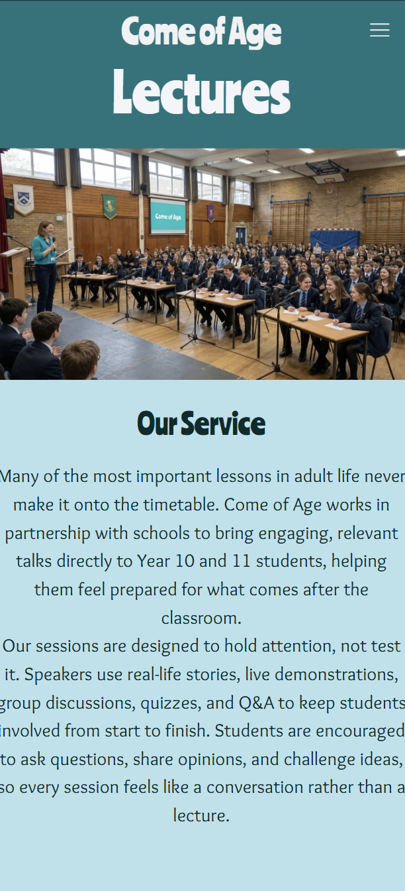
    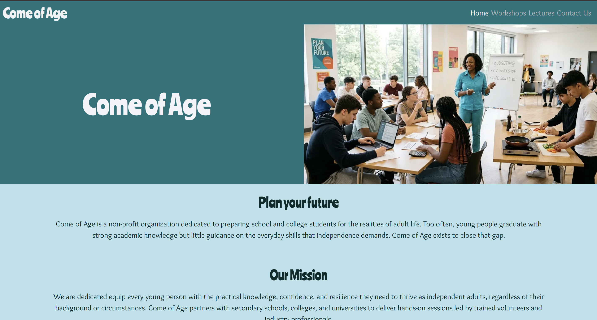

2. As a school staff member, I need a simple form to contact the organisation so I can coordinate workshops and lectures for students.
    - Name, email and message are required.
    - Given all required fields are valid, when the user submits, then a confirmation message is displayed.
    - Form fields have visible labels.
    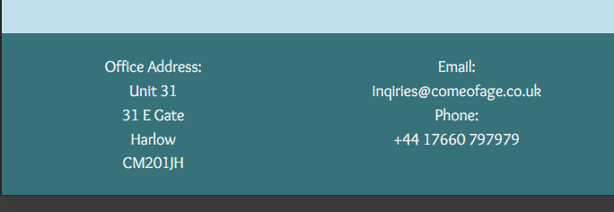

This is not implimented in this build due to time constraints. However the contact details of the organisation is displayed in the footer and the contact us link in the navbar links to the footer making it easier to find.

3. As a student, I need a clear list of workshops so I can find the one I need easily.
    - A dedicated Workshops page lists all available workshops.
    - Each workshop shows a title, short description, date and duration.
    - Workshops are presented in a consistent layout
    - Each workshop has a link or button to see more details or enquire.
    - The list is easy to read, with clear headings and evenly spaced.
    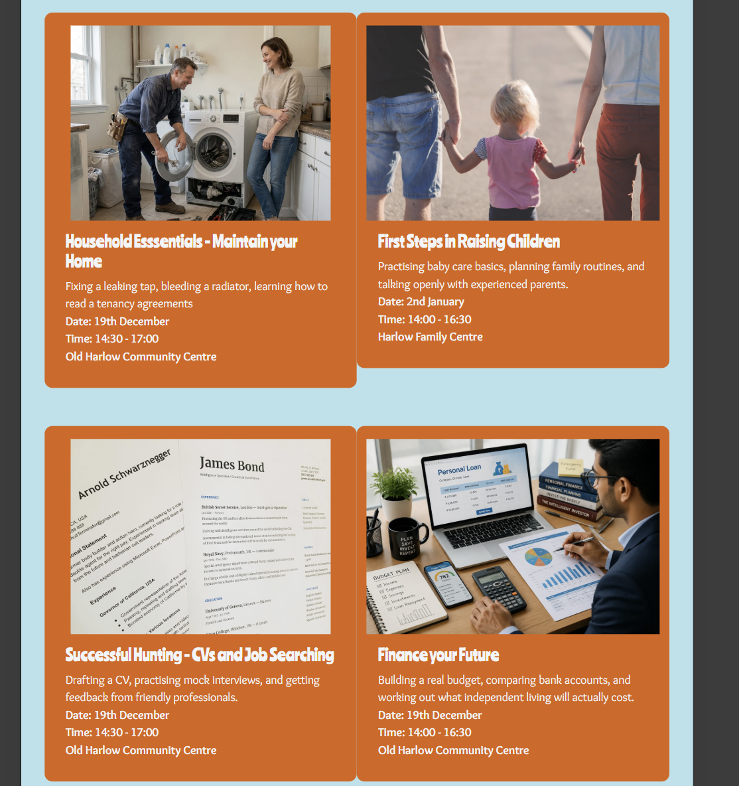

4. As a student, I would like to sign up to a newsletter so i can find up-to-date information about future workshops and events.
    - The form fields are required to be filled for the form to be submitted.
    - Given a valid information, when the user submits, then a success message is shown.
    - Given an invalid or empty email, when the user submits, then an error message is shown.
    - Fields are labled clearly.
    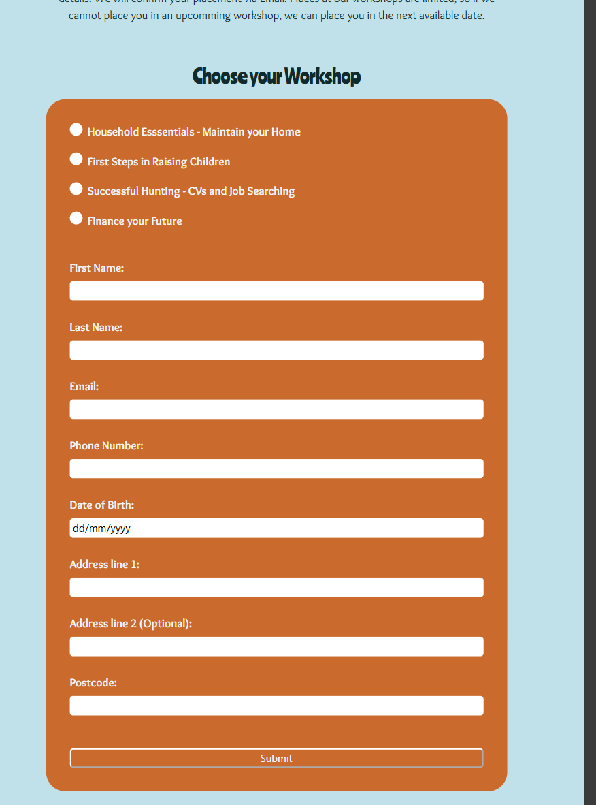
    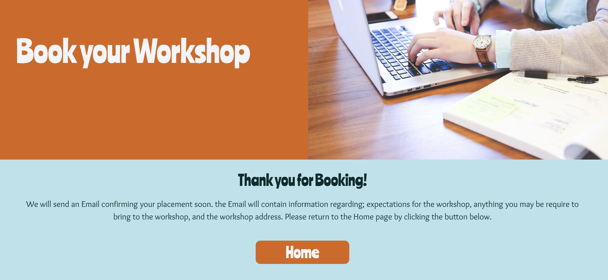
This is not in the final build. instead a workshop booking form was implimented in its place. It covers the same requirements as above.


5. As a potential client, I need to see clear images and layout so I can better understand the information given on the site.
    - All images are high-resolution and display sharply on desktop and mobile.
    - Images are relevant to the page the user is on.
    - Every image has descriptive alt text.
    - Layout uses consistent spacing, alignment and heading hierarchy throughout.
    - Content is broken into sections so information is easy to find.
    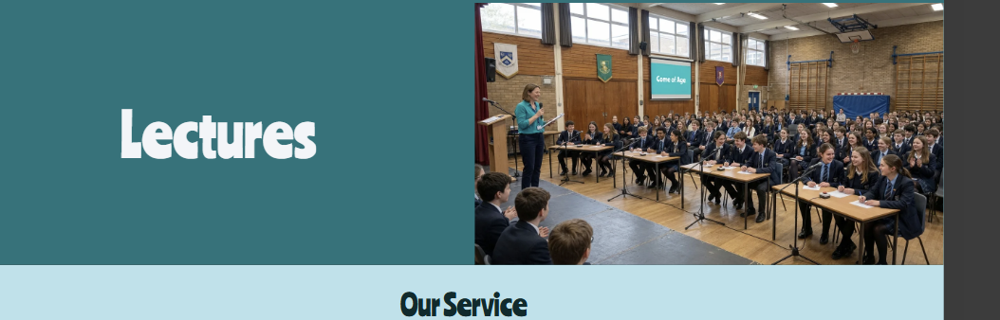

6. As a teacher, I would like to see a number of links to social media and online resourses so i can see if booking  a workshop is good for my students.
    - Links to the social media are visible in the header or footer on every page.
    - A resources section or page lists relevant external links.
    - All links work and lead to the correct destination.
    - External links open in a new tab.
    - Links are checked and none are broken.
    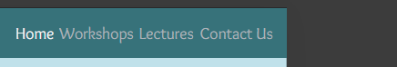
    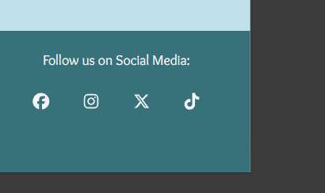
There are no external reasources in this currently this build. links to social media are in the footer.


7. as A student, I want to read testimonials from these workshops to see if joining one is right for me.
    - A testimonials section or page is accessible from the main navigation or homepage.
    - Each testimonial includes the quote and the name or role of the person.
    -At least 3 testimonials are displayed at launch.
    - Testimonials are displayed in a readable format that works on mobile and desktop.
    - Where possible, each testimonial states which workshop it refers to.
    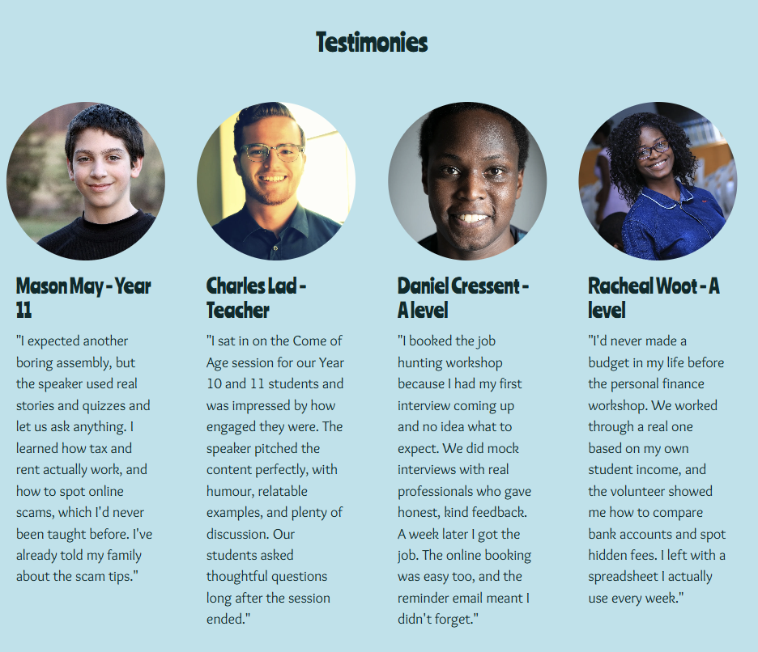

8. As a client, I need there to be a user friendly layout and navigation so I can quickly find the information I need about the services provided.
    - A main navigation menu appears consistently on every page.
    - Navigation labels are clear and descriptive.
    - The current page is visibly highlighted in the navigation.
    - The logo or site name links back to the homepage.
    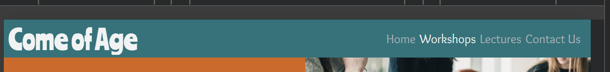
    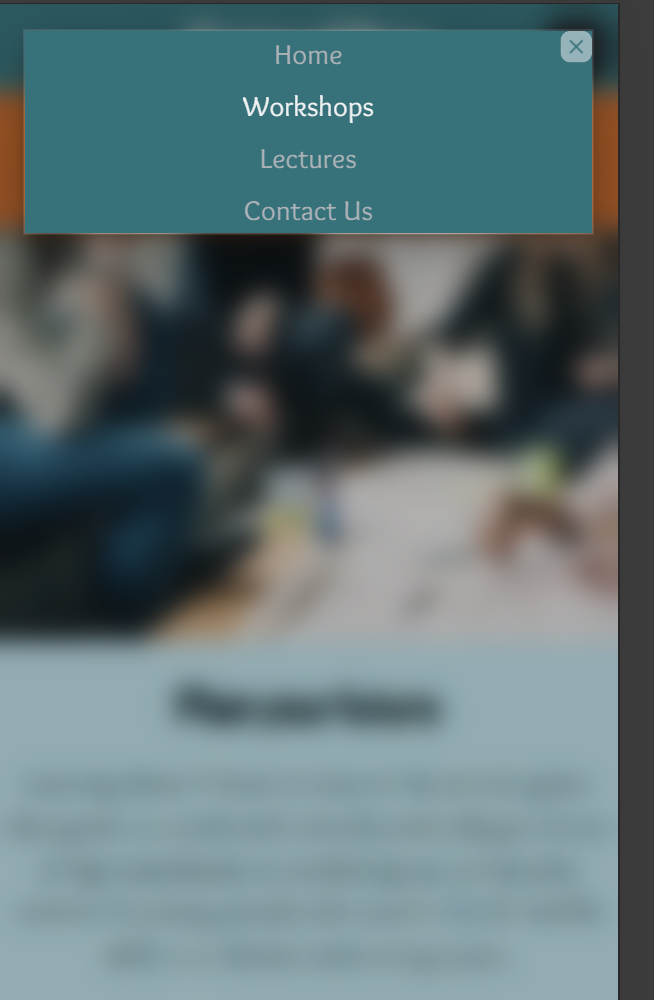

### Features on release

1. A simple navigation bar that colapses into a drop down on small screens
2. Form for booking Workshops
3. responsive website for all devices
4. footer with links to social media and contact info
5. Testimonies section from students and teachers

### Features for future releases
1. contact form for feedback and inquiries
2. form to sign-up for newsletter
3. external reasource links
### Design 

#### Colour Scheme

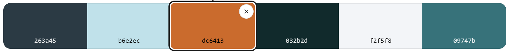 

* Primary Text - #032b2d (charcoal)
* Secondary Text - #263a45 (Dark navy)
* Highlight Text - #f2f5f8 (off-white)
* Background - #b6e2ec (pale blue)
* Header and footer - #09747b (dark turquoise)
* contrast - #dc6413 (orange)

Chosen through [Colour Picker](https://imagecolorpicker.com/) using image generated through [Gemini](https://gemini.google.com/)

Using following prompt

"Realistic photograph of a bright, airy life skills workshop for late teenagers in a modern community centre. A friendly teacher in a turquoise shirt stands at the front, clearly visible and fully in frame, mid-demonstration and smiling. Around them, a group of engaged 17 to 19-year-olds sit at shared tables, taking notes, asking questions, and working on practical tasks such as a budgeting worksheet, a laptop with a CV template, and a simple cooking setup. Large windows flood the room with natural daylight, and the lighting is bright, even, and neutral. Casual, relaxed, and welcoming atmosphere, diverse group, shallow depth of field, 35mm lens, high resolution, photorealistic."

Assisted by [Claude](https://claude.ai/) 


#### Typography

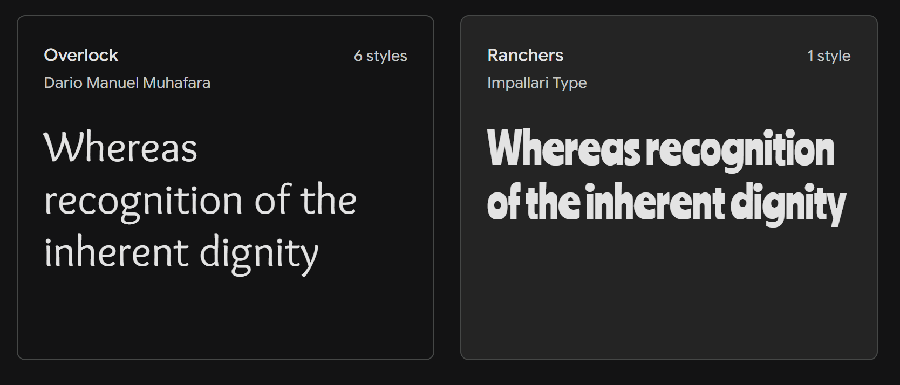

Chosen and linked from [Google fonts](https://fonts.google.com/share?selection.family=Overlock:ital,wght@0,400;0,700;0,900;1,400;1,700;1,900|Ranchers)

* Titles -  Ranchers - Bold and loud while still very readable.

* Secondary - Overlook - Has a hand-written look to it with rounded edges but is still sophisticated and readable. 


CSS code for fonts 

@import url('https://fonts.googleapis.com/css2?family=Overlock:ital,wght@0,400;0,700;0,900;1,400;1,700;1,900&family=Ranchers&display=swap');


#### Images

Stock images are taken from [iStockphoto](https://www.istockphoto.com/)

#### Wireframes

Created using [Whimsical](https://whimsical.com/slhcode/home-page-12XEufmVGuGHgjxTAYmH9c)

Home page

Workshops

Lectures

ContactUs

Booking Workshop
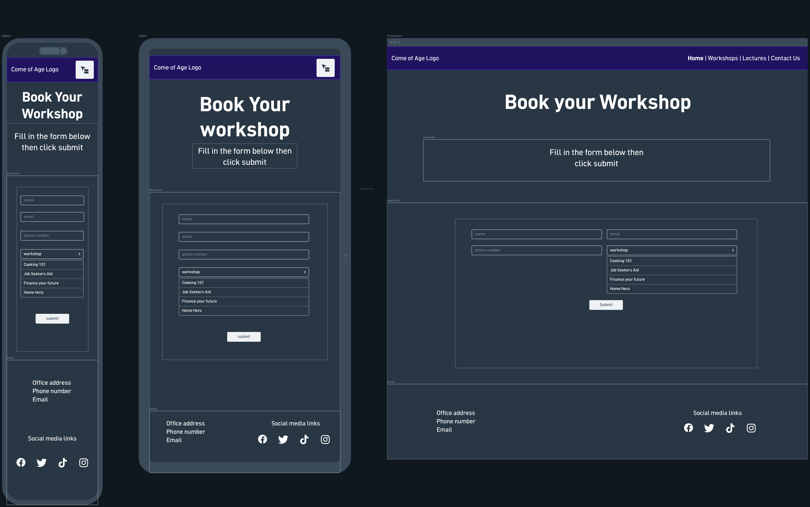
Booking Success


## Technologies
### Site Build
* HTML - Using semantic design for accessiblity 
* CSS - Stylesheets 
* Javascript (using [Bootstrap 6.0](https://getbootstrap.com/)) - navigation, forms and responsive design
* VS Code - Text/code editor
* Chrome web tools - debugging
* W3C Validator - code validation and debugging

### Documentation

* Git/Github - Versioning, Project management, Deployment
* Whimsical - Wireframing 
* Lighthouse - Automated testing

### Assets

* Gemini - AI Image generation
* Claude - text generation for site and prompts for gemini
* Pixabay - Royalty Free Stock Images
* Image Color Picker - Colour scheme for site
* Google fonts - Fonts for site
* Fontawesome - Icons 
* Favicon.io - Favicons
* Pixlr - Free image format convertion

## Testing
### Automated - Lighthouse
scores were taken after validating the code. performance can be improved in various ways but these imporvements must be done in a future build, due to time constraints on this project.
* index.html

    - Mobile
    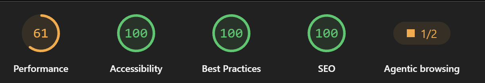
    - Desktop
    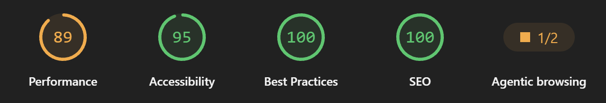

* workshop.html

    - Mobile
    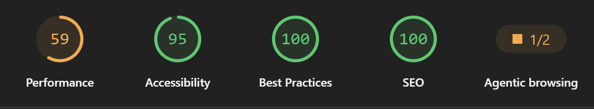
    - Desktop
    

* lectures.html

    - Mobile
    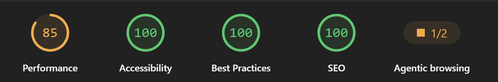
    - Desktop
    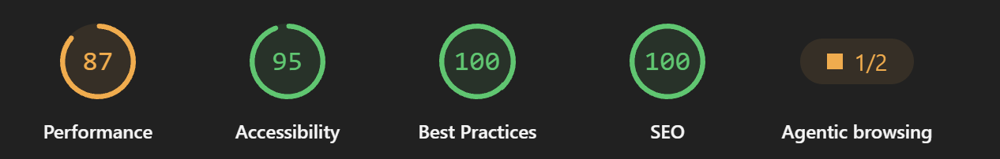

* book-workshop.html

    - Mobile
    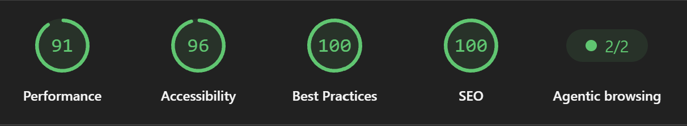
    - Desktop
    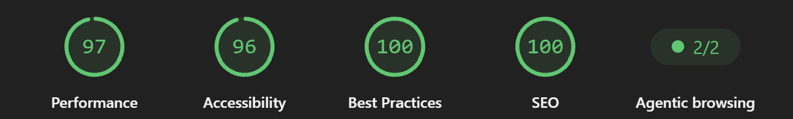

* success.html

    - Mobile
    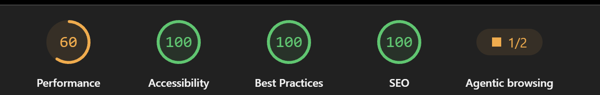
    - Desktop
    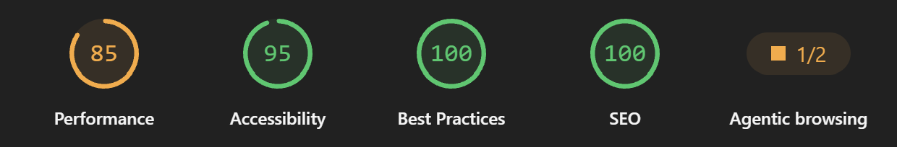

### Manual
* Chrome Dev tools - Testing responsive design with screen presets.
* Tested with different devices:
    - Tablet - Samsung Galaxy Tab S 8
    - Phone - Google Pixel 7 
    - Laptop - Lenovo Ideapad Pro 5
* Tested on Different Browsers
    - Google Chrome
    - Firefox
    - Microsoft Edge


## Validation
Validator used - W3C Validator
### HTML
* index.html
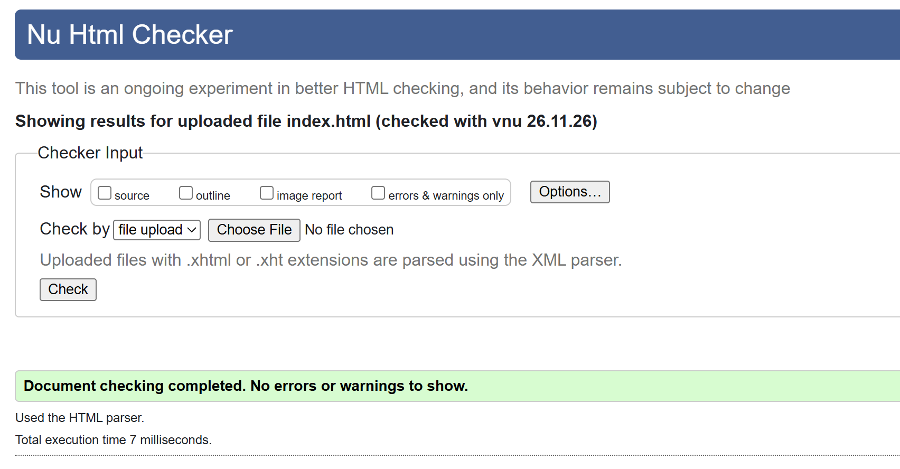
* workshop.html
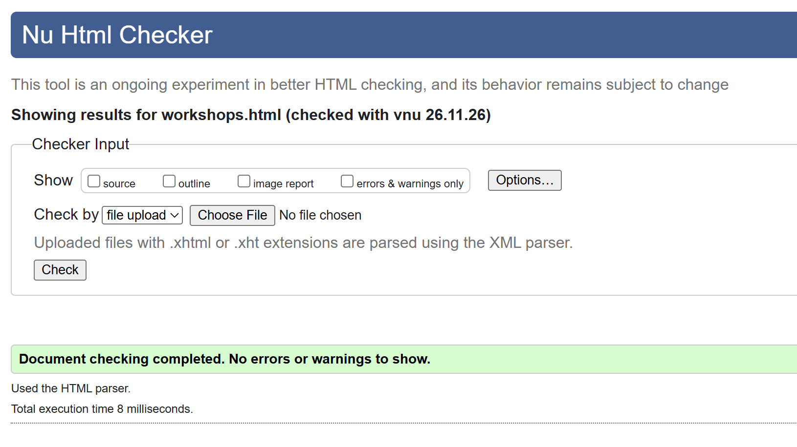
* lectures.html
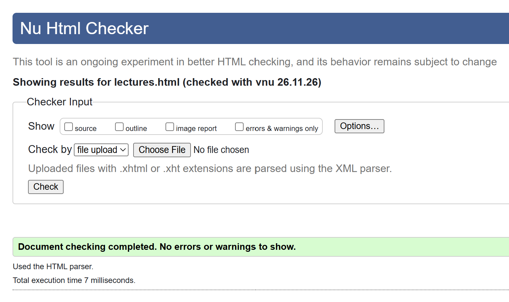
* book-workshop.html
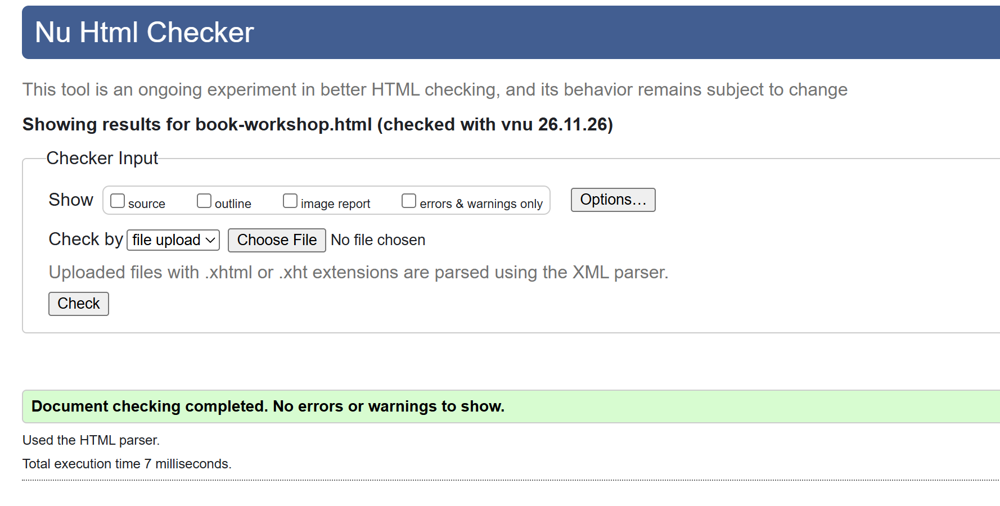
* success
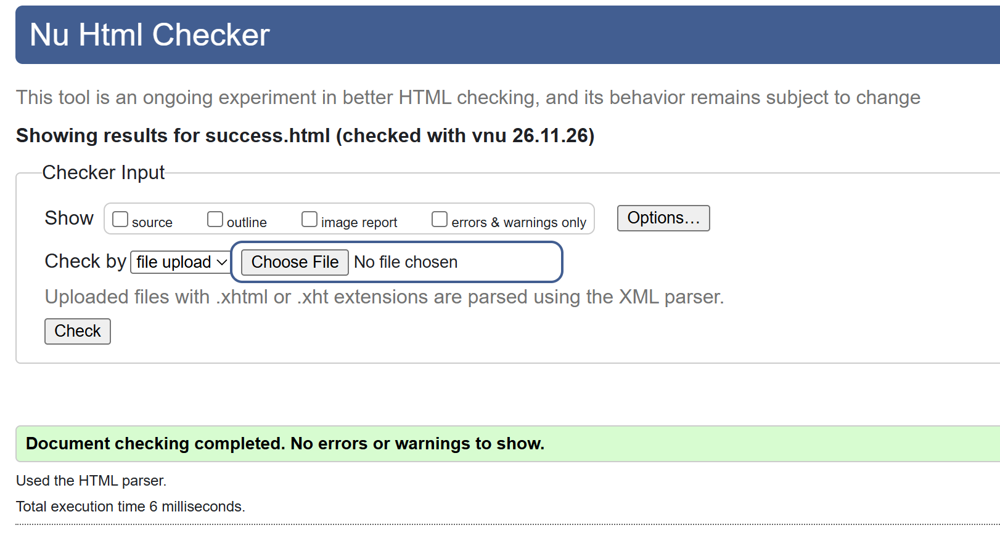


### CSS

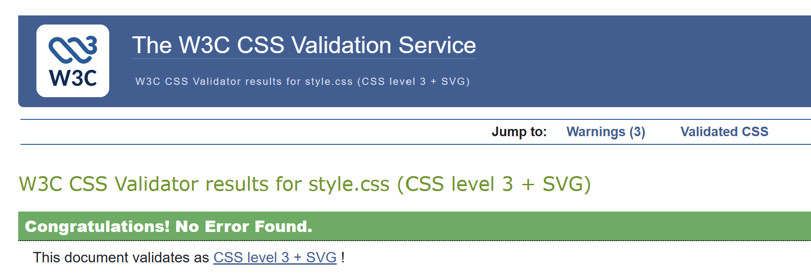

## Bugs

### 1. Main not covering the full width of view port


This was caused by the width of "body" tag not being defined properly in style.css. After manuel testing of the "main" tag, the body tag was deemed to be the root cause.

### 2. Header not showing at the top under nav bar
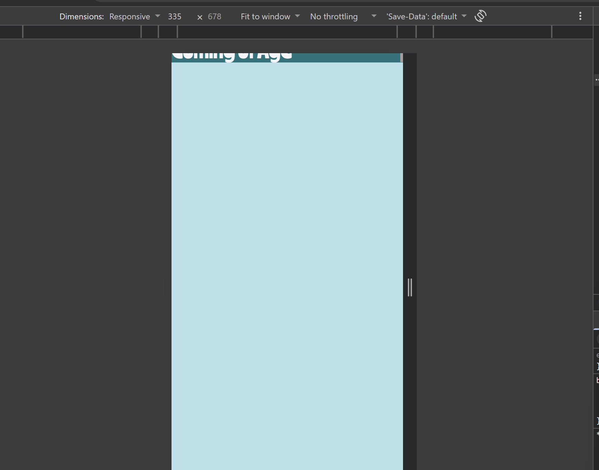

This was caused when applying "position: fixed" to the "nav" tag. "position: sticky" was tested and did not work. after consulting code institute lms learning platform, applying "margin-top: 65px" to "header" tag fixed this issue. 

### 3. scroll on various bits of text
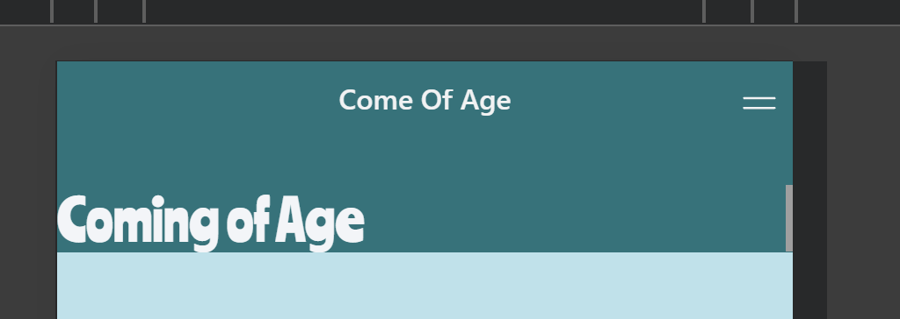

This affected is believed to be affected by the global styling used in all pages and in each section. It is possible that the global style for "overflow-y: hidden". this styling was removed and was not the cause. Using ai assistance in google web tools, "overflow: hidden !important" was added to any affected elements. this fixed this bug for now but needs further diagnois to find the root cause.

### 4. clipping of text in the footer


This was found while testing responsiveness in web tools. this appears if the width of the view-port is 576px - 715px. this is caused by the padding applied to the "footer" elements. This can be fixed by using a media query for these elements to change the spacing between these width levels, also by altering padding or applying text-wrapping to ".footer-info". However, due to time constraints, and the fact that this range was deemed uncommon for modern device view-ports, this will be fixed in a future build.

### 5.Main body not filling remaining space of viewport


Found while testing tablet presets in web tools. A fix for this was found on stackoverflow https://stackoverflow.com/questions/90178/make-a-div-fill-the-height-of-the-remaining-screen-space. 

### 6. nav dialog menu pinned to the right 
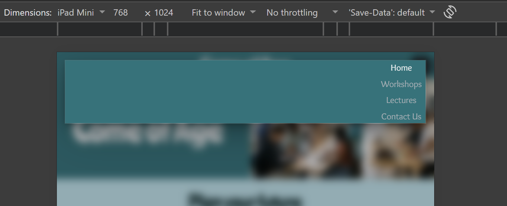

This was found using the ipad mini preset in web tools. its cause by a bootstrap class "md:justify-content-end" in "dialog" not synced with the colapsing functionality of the bootstrap nav. Testing by changing this class to "sm:" and "lg" but was not fixed. Another possible fix for this could be a media query to added to this element to overwrite bootstrap, but due to time constraints, this must be added in a future build.

## External Code
Most external code snippets are taken from Bootstrap:

### Navbar
Taken and altered from:
https://getbootstrap.com/docs/6.0/components/navbar/
```
<nav class="navbar md:navbar-expand bg-1 fg-2 position-fixed top-0 start-0 end-0 z-fixed">
        <div  class="container-fluid justify-content-center position-relative">
            <a class="navbar-brand " href="index.html"><h2 >Come of Age</h2></a>

            <button class="btn-icon navbar-toggler position-absolute end-0" type="button" data-bs-toggle="drawer" data-bs-target="#navbarNav" aria-controls="navbarNav" aria-expanded="false" aria-label="Toggle navigation">
                <span class="navbar-toggler-icon" aria-hidden="true"></span>
            </button>

            <dialog class="drawer drawer-top end-0 align-items-center md:align-items-end rounded-0" tabindex="-1" id="navbarNav" aria-labelledby="navbarNavLabel ">
                
                <button type="button" class="btn-close position-absolute end-0 top-0 sm:d-none
            " data-bs-dismiss="drawer" aria-label="Close"></button>
                <div class="drawer-body justify-content-center">
                    <ul class="navbar-nav ">
                        <li class="nav-item justify-content-center">
                            <a class="nav-link active " aria-current="page" href="index.html">Home</a>
                        </li>
                        <li class="nav-item justify-content-center">
                            <a class="nav-link" href="workshops.html">Workshops</a>
                        </li>
                        <li class="nav-item justify-content-center">
                            <a class="nav-link" href="lectures.html">Lectures</a>
                        </li>
                        <li class="nav-item justify-content-center ">
                            <a class="nav-link" href="#bottom">Contact Us</a>
                        </li>
                    </ul>
                </div>
            </dialog>
        </div>
    </nav>
```

### Cards

Taken and altered from: https://getbootstrap.com/docs/6.0/components/card/
This is used for testimony cards and workshop cards
```
<div class="container card-section">
                    <div class="row row-cols-1 lg:row-cols-2 g-4 card-wrapper">
                        <div class="col">
                            <div class="card workshop-card">
                            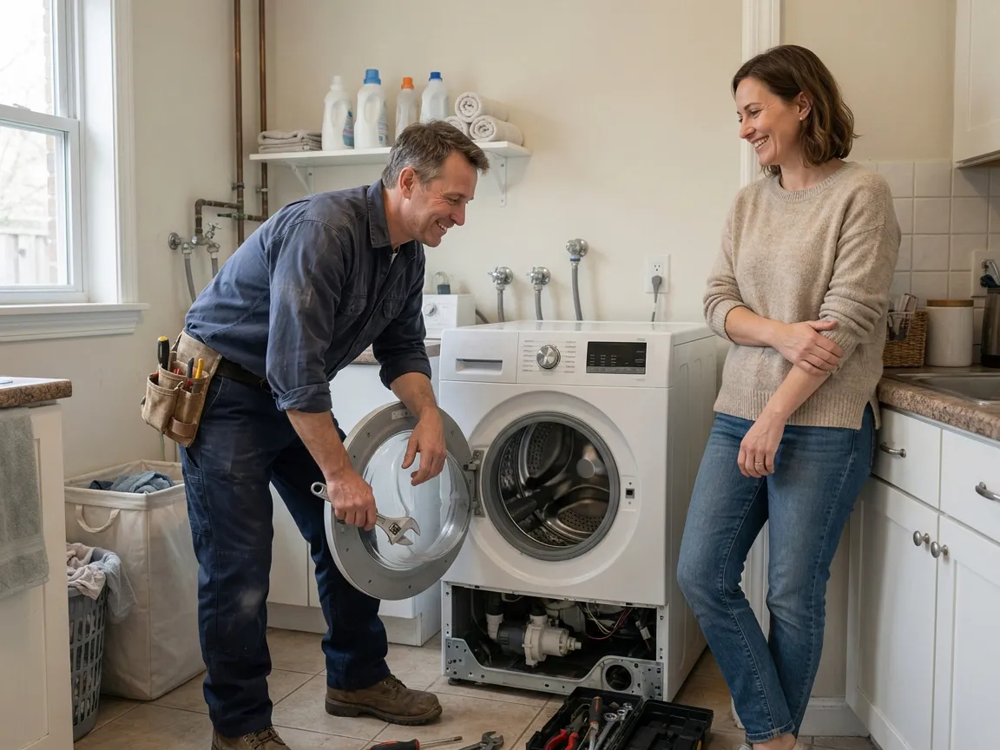
                            <div class="card-body">
                                <h3 class="card-title">Household Esssentials - Maintain your Home</h3>
                                <p class="card-text">Fixing a leaking tap, bleeding a radiator, learning how to read a tenancy agreements
                                    <br>
                                    <strong>Date: 19th December</strong>
                                    <br>
                                    <strong>Time: 14:30 - 17:00 </strong>
                                    <br>
                                    <strong>Old Harlow Community Centre</strong>
                                </p>
                            </div>
                            </div>
                        </div>
```                     
### Form Radio

Taken and altered from: https://getbootstrap.com/docs/6.0/forms/radio/
```
                    <div class="workshop-selector ">
                        <div class="form-field select">
                            <input class="radio" name="radios" type="radio" id="radioLabel" >
                            <label for="radioLabel">Household Esssentials - Maintain your Home</label>
                        </div>
                        <div class="form-field select">
                            <input class="radio" name="radios" type="radio" id="radioLabel2" >
                            <label for="radioLabel2">First Steps in Raising Children</label>
                        </div>
                        <div class="form-field select">
                            <input class="radio" name="radios" type="radio" id="radioLabel3">
                            <label for="radioLabel3">Successful Hunting - CVs and Job Searching</label>
                        </div>
                        <div class="form-field select">
                            <input class="radio" name="radios" type="radio" id="radioLabel4">
                            <label for="radioLabel4">Finance your Future</label>
                        </div>
                    </div>

```  

### Bug fixes

Taken from ai assitant in chrome dev tools
```
/*fix for bug with text scroll*/
nav div.container-fluid, h1,p,h3,h4,h2{
    overflow: hidden !important;
}
```
fixes scolling bug

taken from: https://stackoverflow.com/questions/90178/make-a-div-fill-the-height-of-the-remaining-screen-space.
```
body{
    margin: 0;
    padding: 0;
    display: flex;
    flex-direction: column;
    width: 100%;
    min-height:100vh;
}


#main-content{
    width: 100vw;
    height: inherit;
    background-color: var(--primary-background-color);
    color: var(--primary-text-color);
    padding-bottom: 1.5rem;
    padding-top: 1.5rem;
    /*fix view height not filling remaining screen*/
    flex: 1 0 auto;
}
```
implimented flex: 1 0 auto to main content and min-height: 100vh to fix main section not filling the remaining space

## Deployment
For developers coming back to this project or new developers taking over the project, please follow these steps below to deploy this application:
* Log into Github
* Find the Github repo 
* Open settings and click on the Pages tab
* Under Build and Development, under branch, click on the drop down menu and choose /main then save
* After a few minutes, refresh the page
* At the top of the screen it will confirm that the website is deployed with a link to visit.

It is important to deploy this application while developing as unexpected issues may arrise on a deployed site that are a non-issue when hosted locally.


## Credits
* [Code Institute LMS](https://lms.codeinstitute.net/) - for the wide range of learning materials and references while building this project
* [Markdown Cheatsheet](https://www.markdownguide.org/cheat-sheet/) - For use in writing this readme
* [Claude](https://claude.ai/) - For use in this readme and on the website, helping with wording user stories and generating prompts, and text for the website
* Paul Thomas from Code Institute - For the helpful calls and advice throughout this project
* [Bootstrap 6.0](https://getbootstrap.com/docs/6.0/) - for api, and documentation of its many uses
* [Pawsome Strolls](https://github.com/Chandni-L5/pawsome-strolls/blob/main/README.md) - For use as a reference when writing this readme
